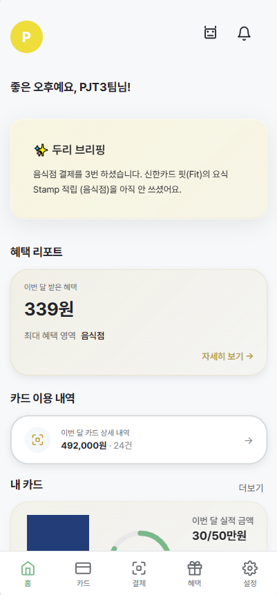
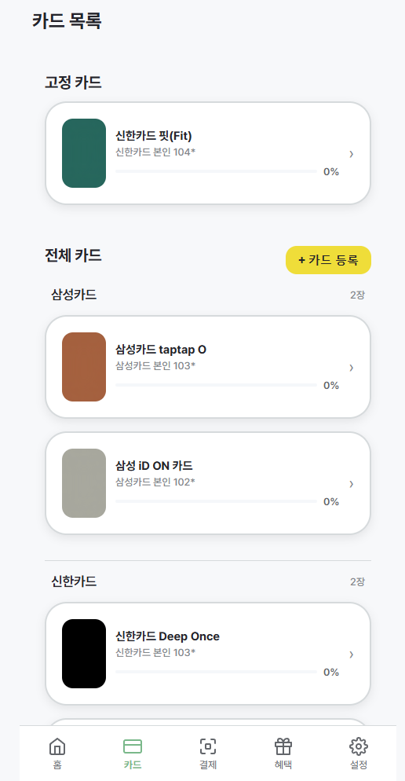
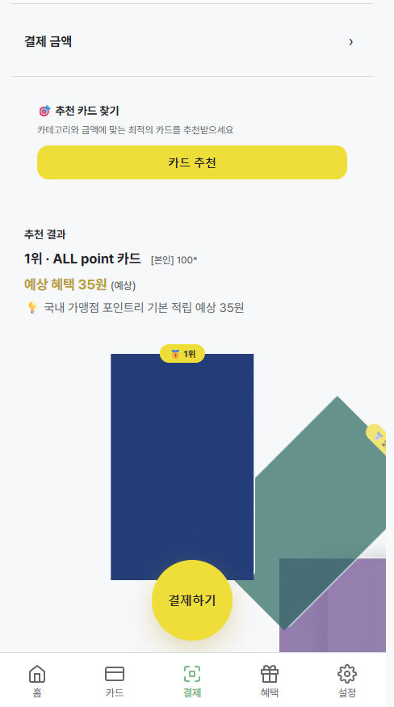
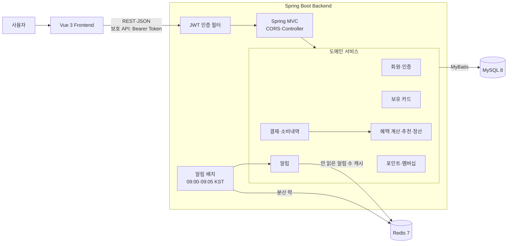
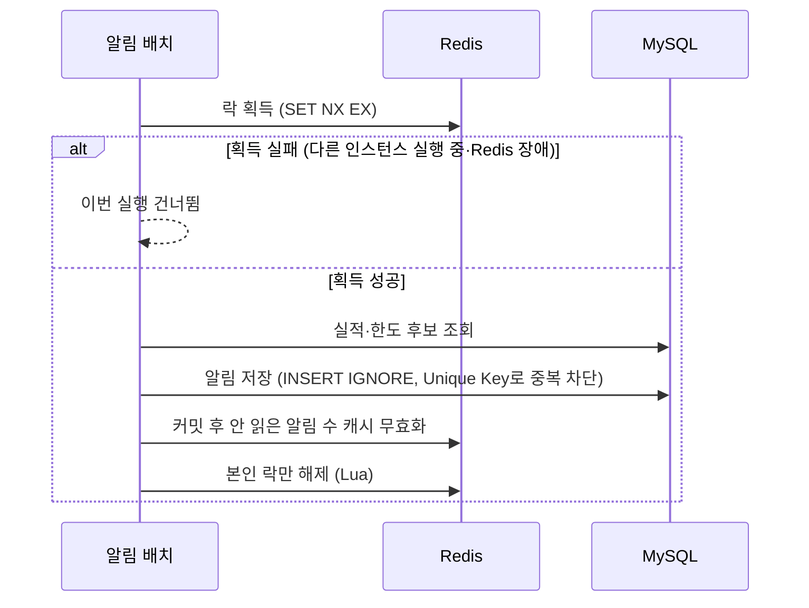

# 두리 (Doori)

보유 카드의 실적과 혜택 조건을 계산하여 결제 직전 가장 유리한 카드를 추천하는 카드 혜택 최적화 전자지갑 서비스입니다.

> 이 저장소는 KB IT's Your Life 7기 종합실무 팀 프로젝트를 기반으로 개인 고도화를 진행한 비상업적 프로젝트입니다. 실제 금융기관, 카드사 및 멤버십 운영사와 제휴·후원·승인 관계가 없습니다. 저장소의 회사명과 서비스명은 기능 및 테스트 데이터 설명을 위한 것이며, 공개 이미지 자산은 실제 브랜드 이미지 대신 가상 카드 이미지로 구성합니다.

## 프로젝트 개요

| 항목             | 내용                                                                                                                                                                                                                            |
| ---------------- |-------------------------------------------------------------------------------------------------------------------------------------------------------------------------------------------------------------------------------|
| 서비스           | 카드 혜택 최적화 전자지갑                                                                                                                                                                                                                |
| 기존 프로젝트    | KB IT's Your Life 7기 종합실무 팀 프로젝트 (팀명: 이고허장)                                                                                                                                                                                   |
| 팀 프로젝트 기간 | 2026-07-09 ~ 2026-08-14                                                                                                                                                                                                       |
| 개인 고도화 기간 | 2026-09-29 ~ 진행 중                                                                                                                                                                                                             |
| 개인 고도화      | 팀 프로젝트 종료 후, 기존 Spring Framework 기반 WAR 애플리케이션의 실행·설정 구조를 개선하고, 코드의 동작을 검증하며 테스트 커버리지와 성능 등 품질 관련 지표를 객관적으로 확인할 수 있는 프로젝트로 발전시키고자 개인 고도화를 진행했습니다. 이를 위해 테스트 및 자동 검증 기반을 구축하고, Spring Boot 기반의 실행 환경과 애플리케이션 구조로 단계적으로 전환했습니다. |
| 고도화 기준선    | [`d340774`](https://github.com/MOIYS/yigo-heojang-springboot/commit/d340774a88c9bbed17440e00513efd04788e736e)                                                                                                                 |

저장소에는 팀 프로젝트의 Frontend와 AI Server도 포함되어 있습니다. 개인 고도화와 이 문서는 **백엔드(Database·Test·CI/CD 포함)를 중심으로 다루며 AI Server는 범위에서 제외**합니다.

<br>

## 프로젝트 목적

카드마다 전월 실적, 할인율, 적립률, 건당 최소 결제 금액, 월 한도 등 혜택 조건이 서로 달라 결제할 때마다 직접 비교하기 어렵습니다.

두리는 보유 카드, 카드별 실적과 남은 한도, 결제 가맹점과 업종, 결제 예정 금액, 포인트·멤버십 정보를 조합하여 현재 결제에 가장 유리한 결제 수단을 추천합니다.

## 서비스 화면

보유 카드와 혜택 현황을 확인하고, 결제 조건에 따라 가장 유리한 카드를 추천받을 수 있습니다.

|                                        메인 화면                                        |                                              카드 목록                                              |                                         결제 화면                                          |
|:-----------------------------------------------------------------------------------:|:-----------------------------------------------------------------------------------------------:|:--------------------------------------------------------------------------------------:|
|  |  |  |
|                                  보유 카드 및 혜택 현황 확인                                   |                                           등록 카드 목록 조회                                           |                                   결제 조건에 따른 최적 카드 추천                                   |

> 위 화면은 기존 팀 프로젝트에서 구현한 서비스 화면입니다.

## 주요 기능

> 아래는 기존 팀 프로젝트에서 구현한 서비스 전체의 주요 기능입니다. 개인 담당 기능은 담당 범위에서 별도로 구분합니다.

| 영역           | 기능                                                                                                                                                                              |
| -------------- | --------------------------------------------------------------------------------------------------------------------------------------------------------------------------------- |
| 회원·인증      | 회원가입·로그인, JWT Access Token 인증, Refresh Token 재발급·로그아웃, 가입 이메일 인증, 비밀번호 재설정, 간편 비밀번호, 회원정보 조회·수정, 회원 탈퇴와 개인정보 삭제·보존 분리  |
| 보유 카드      | 카드번호 기반 등록 (Mock 카드번호 매칭), 목록·상세 조회, 삭제, 대표 카드 지정                                                                                                     |
| 혜택 계산·추천 | 전월 실적 산정, 실적 구간·혜택 조건 판정, 정액·정률·묶음 한도 계산, 가맹점·업종별 적용 혜택 조회, 결제 금액 기준 최적 카드 추천, 소비내역 기반 신규 카드 추천, 기간별 혜택 리포트 |
| 결제·소비내역  | 결제 요청·결과 조회, QR 결제 생성·조회·실행, 소비 취소 시 실적·한도 역산 반영, 소비내역 목록·상세·필터 조회                                                                       |
| 포인트·멤버십  | 보유 포인트·사용내역 조회, 결제 시 포인트 사용 안내, 멤버십 등록·해제·상세 조회, 주요 사용처 제공                                                                                 |
| 알림           | 알림 목록·읽음·삭제, 수신 설정, 실적 부족·혜택 한도 임박·소진 알림, 일 배치 생성                                                                                                  |

<br>

## 담당 범위

### 기존 팀 프로젝트

팀 프로젝트에서 **회원·인증, 보유 카드, 알림** 영역의 백엔드 구현을 담당했습니다.

**회원·인증**

- 회원가입·로그인, JWT 인증 및 Refresh Token 재발급·로그아웃
- 가입 이메일 인증, 비밀번호 재설정, 간편 비밀번호 설정·검증
- 약관 조회와 가입·탈퇴 시 약관 동의 이력 저장
- 회원정보 조회·수정
- 회원 탈퇴 시 개인정보 익명화, 원본 분리 보관, 관련 데이터 삭제

**보유 카드**

- Mock 카드번호 매칭 기반 카드 등록
- 보유 카드 목록·상세 조회, 삭제
- 대표 카드 지정·조회

**알림**

- 알림 목록·읽음·삭제, 안 읽은 알림 수 조회, 수신 설정
- 실적 부족·혜택 한도 임박·소진 알림 정책 정의와 후보 계산
- 후보가 많을 때 묶음 알림 생성
- 매일(Asia/Seoul) 실행되는 알림 배치(실적 부족 09:00, 혜택 한도 09:05)와 관리자 수동 실행 API
- Redis 안 읽은 알림 수 캐시 및 장애 시 MySQL 조회 대체
- Redis 분산 락 기반 배치 중복 실행 방지
- MySQL Unique Key 기반 중복 알림 방지

알림 정책과 동작 조건은 [알림 규칙 문서](docs/notification-rules.md)에 정리되어 있습니다.

### 개인 백엔드 고도화

애플리케이션 구조를 변경하기에 앞서, 기존 동작과 변경 결과를 검증할 수 있는 기반을 먼저 마련했습니다.

특성 테스트(Characterization Test)와 API 계약 테스트로 기존 동작을 고정하고, JaCoCo와 k6를 통해 테스트 커버리지 및 성능 기준선을 확보했습니다. 이후 기존 API 계약을 유지하면서 실행 환경과 프레임워크를 단계적으로 전환하고, 검증 체계를 CI에 통합했습니다.


| 구분        | 기존 팀 프로젝트                   | 현재                                                        |
| ----------- | ---------------------------------- | ----------------------------------------------------------- |
| Java        | 17                                 | 21                                                          |
| 프레임워크  | Spring Framework 5.3 (Legacy)      | Spring Boot 4.1 / Spring Framework 7                        |
| Servlet API | `javax.servlet`                    | `jakarta.servlet`                                           |
| 배포        | WAR + 외부 Tomcat 9                | 실행 JAR + 내장 Tomcat                                      |
| Spring 설정 | XML Context                        | Java Config + Boot 자동 구성                                |
| JSON        | Jackson 2 `ObjectMapper` 수동 등록 | Jackson 3 자동 구성 `JsonMapper` (Jackson 2 호환 설정 유지) |
| DB 스키마   | `schema.sql` 수동 실행             | Flyway V1 마이그레이션                                      |
| JWT Secret  | 소스 코드 하드코딩                 | 환경변수 외부화, 누락 시 기동 실패                          |
| API 검증    | 수동 확인                          | Newman API 계약 테스트 (CI에서 실행 JAR 대상)               |
| 테스트      | 단위·일부 통합 테스트              | 특성 테스트, 실제 MySQL·Redis 통합 테스트 보강              |
| CI          | 백엔드 테스트, 프론트엔드 빌드     | Newman, JaCoCo 리포트, gitleaks Secret 검사 추가            |
| 성능        | 기준 없음                          | k6, Boot 전환 전 기준선                                     |

진행 순서는 다음과 같습니다.

### 진행 과정

| 단계                             | 주요 작업 | 관련 PR |
|--------------------------------| --- | --- |
| 1. 검증·측정 기반 확보                 | 인증·알림 특성 테스트, JaCoCo 커버리지 측정, Newman API 계약 기준선, k6 성능 기준선 | [#4](https://github.com/MOIYS/yigo-heojang-springboot/pull/4), [#6](https://github.com/MOIYS/yigo-heojang-springboot/pull/6), [#8](https://github.com/MOIYS/yigo-heojang-springboot/pull/8), [#10](https://github.com/MOIYS/yigo-heojang-springboot/pull/10), [#12](https://github.com/MOIYS/yigo-heojang-springboot/pull/12) |
| 2. 실행 환경 및 민감 정보 관리 정비         | Java 21 통일, Secret 외부화, PR Secret 검사 | [#14](https://github.com/MOIYS/yigo-heojang-springboot/pull/14), [#40](https://github.com/MOIYS/yigo-heojang-springboot/pull/40), [#43](https://github.com/MOIYS/yigo-heojang-springboot/pull/43) |
| 3. Spring Boot 기반 전환           | Spring Boot 3.5 실행 JAR 전환, Jakarta Servlet API 적용, Java Config 이관, Flyway 도입 | [#45](https://github.com/MOIYS/yigo-heojang-springboot/pull/45), [#47](https://github.com/MOIYS/yigo-heojang-springboot/pull/47), [#49](https://github.com/MOIYS/yigo-heojang-springboot/pull/49) |
| 4. Spring Boot 4 전환 및 계약 검증 강화 | Newman CI 통합, API 계약 테스트 보강, Spring Boot 4.1 및 Jackson 3 전환 | [#63](https://github.com/MOIYS/yigo-heojang-springboot/pull/63), [#67](https://github.com/MOIYS/yigo-heojang-springboot/pull/67), [#70](https://github.com/MOIYS/yigo-heojang-springboot/pull/70), [#71](https://github.com/MOIYS/yigo-heojang-springboot/pull/71) |

Java Config 이관 과정과 세부 설정은 [Java Config 이관 결과](backend/docs/java-config-migration.md)에 정리되어 있습니다.

## 시스템 구성


> Frontend는 공개 API를 제외한 보호 API 요청에 Access Token을 첨부하며, Backend JWT 필터가 이를 검증합니다.

| 저장소 | 역할                                                                    |
| ------ | ----------------------------------------------------------------------- |
| MySQL  | 회원·카드·혜택·결제·알림 등 전체 업무 데이터, 중복 알림 방지 Unique Key |
| Redis  | 안 읽은 알림 수 캐시(장애 시 MySQL 조회), 알림 배치 분산 락             |

### 알림 배치 흐름



분산 락은 여러 인스턴스의 동시 실행을 막고, MySQL Unique Key는 재실행 시 중복 저장을 막습니다.

## 기술 스택

| 구분 | 기술                                              |
| --- |-------------------------------------------------|
| Backend | Java 21, Spring Boot 4.1, Spring MVC, Jackson 3 |
| Data Access | MyBatis 3.5, Jedis, Flyway                      |
| Database·Cache | MySQL 8, Redis 7                                |
| Authentication·Mail | JJWT, Spring Mail                               |
| Frontend (팀 프로젝트) | Vue 3, Vite, Pinia, Vue Router, Axios           |
| Test | JUnit 6, AssertJ, Spring Boot Test              |
| API·Performance Test | Postman, Newman, k6                             |
| Quality·CI | JaCoCo, gitleaks, GitHub Actions                |
| Build | Maven Wrapper                                   |
## 저장소 구조

```text
.
├── backend/       # Spring Boot 백엔드
├── frontend/      # Vue 프론트엔드
├── api-test/      # Newman API 계약 테스트
├── performance/   # k6 성능 테스트 및 기준선
├── docs/          # 기술 문서
└── ai-server/     # AI 서버 (개인 고도화 범위 제외)
```

## 시작하기

요구 환경: JDK 21, Node.js 24, Docker

| 순서 | 작업 | 문서 |
| --- | --- | --- |
| 1 | 환경변수 설정, MySQL·Redis 준비, Flyway 및 Seed 초기화, 백엔드 실행 | [Backend 실행 가이드](backend/README.md) |
| 2 | 프론트엔드 의존성 설치 및 실행 | [Frontend 실행 가이드](frontend/README.md) |

API 계약 테스트와 성능 테스트의 실행 방법은 각 테스트 문서를 참고합니다.

## 테스트·검증

| 종류             | 도구                        | 문서                                   |
| ---------------- |---------------------------|--------------------------------------|
| 단위·통합 테스트 | JUnit 6, Spring Boot Test | [backend](backend/README.md)         |
| API 계약 테스트  | Newman                    | [api-test](api-test/README.md)       |
| 커버리지         | JaCoCo                    | -                                    |
| Secret 검사      | gitleaks (PR 변경 범위)       | -                                    |
| 성능 기준선      | k6                        | [performance](performance/README.md) |

## 프로젝트 한계

- 결제는 실제 PG가 아닌 Mock 채널로 처리합니다.
- Spring Boot 전환 후, 성능 재측정과 전후 비교는 아직 진행하지 않았습니다.
